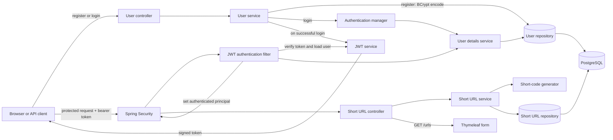
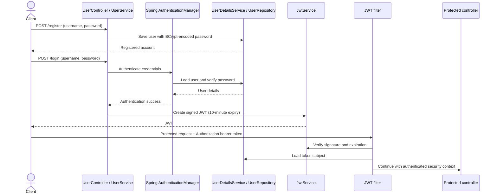
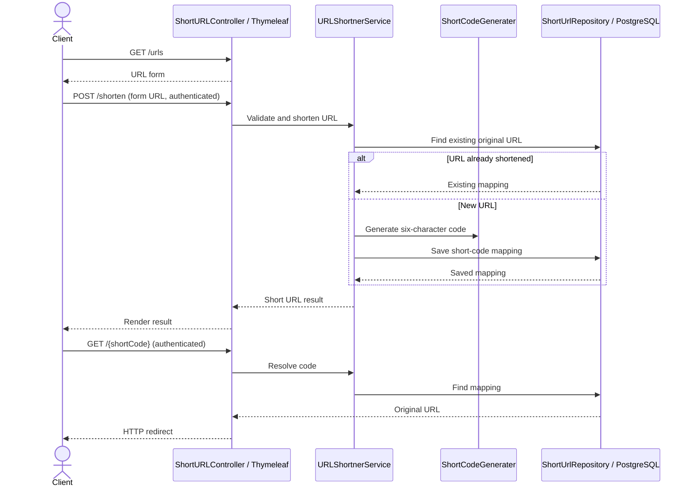

# URL Shortener

A Spring Boot application that creates six-character short links, stores them in PostgreSQL, and redirects short links to their original URLs. The web form is rendered with Thymeleaf. Registration and login are exposed as JSON endpoints, and the protected routes accept JWT bearer tokens (Spring HTTP Basic is also enabled).

## Architecture



### Main flows





The security configuration permits `/register` and `/login`; all other routes require authentication. HTTP Basic is also enabled. The JWT signing key is currently defined in `JwtService`; do not commit or expose production signing keys. Move the key to secure external configuration and rotate it before deployment.

## HTTP endpoints

All URLs below are relative to `http://localhost:8082`. Except for registration and login, requests require authentication. For JWT authentication, include the token in the `Authorization` header using the bearer scheme.

| Method | Path | Authentication | Request and result |
| --- | --- | --- | --- |
| `POST` | `/register` | Public | JSON `{"username":"alice","password":"your-password"}`; registers the account. |
| `POST` | `/login` | Public | JSON with the same `username` and `password`; returns a signed JWT on success. |
| `GET` | `/urls` | Required | Renders the URL-shortening form (`index`). |
| `POST` | `/shorten` | Required | Form field `url`; validates and shortens the URL, then renders the result in the form page. |
| `GET` | `/{shortCode}` | Required | Redirects to the original URL, or returns 404 if the code is unknown. |
| `GET` | `/token` | Required | Returns the request's CSRF token. CSRF protection is disabled in the current security configuration, so this endpoint is not needed for the JWT examples. |

`POST /shorten` is currently a Thymeleaf form endpoint, not a JSON API: it accepts `application/x-www-form-urlencoded` data and returns HTML. The redirect endpoint is also protected by the current catch-all authorization rule, so browsers must send credentials (for example, HTTP Basic) when following a short link; API clients can send the bearer header.

### Example requests

Register a user and obtain a token:

```bash
BASE_URL=http://localhost:8082

curl -i -X POST "$BASE_URL/register" \
  -H 'Content-Type: application/json' \
  -d '{"username":"alice","password":"your-password"}'

curl -i -X POST "$BASE_URL/login" \
  -H 'Content-Type: application/json' \
  -d '{"username":"alice","password":"your-password"}'
```

Copy the token returned by `/login` and set it for the protected requests:

```bash
TOKEN='<paste-login-token-here>'
AUTH_SCHEME=Bearer

curl -i "$BASE_URL/urls" \
  -H "Authorization: $AUTH_SCHEME $TOKEN"

curl -i -X POST "$BASE_URL/shorten" \
  -H "Authorization: $AUTH_SCHEME $TOKEN" \
  -H 'Content-Type: application/x-www-form-urlencoded' \
  --data-urlencode 'url=https://example.com'
```

Use the short code shown in the HTML response to test the redirect:

```bash
SHORT_CODE='<short-code-from-response>'
curl -i "$BASE_URL/$SHORT_CODE" \
  -H "Authorization: $AUTH_SCHEME $TOKEN"
```

The redirect response is normally `302 Found` with a `Location` header. Add `-L` to `curl` if you also want to follow it.

## Requirements and configuration

- Java 17+
- PostgreSQL
- Maven (or use the included Maven wrapper)

The active datasource configuration targets PostgreSQL. By default, `DB_URL` points to `jdbc:postgresql://localhost:5432/postgres`; configure `DB_URL`, `DB_USERNAME`, and the datasource password property for your local database. Do not commit real database credentials. Flyway runs the migration in `src/main/resources/db/migration` to create the `short_urls` table. JPA is configured with `ddl-auto=update` for entity schema updates.

## Run the application

1. Start PostgreSQL and create or select a database. Set the datasource URL, username, and password using the properties/environment configuration in `src/main/resources/application.properties`.
2. From the repository root, start Spring Boot:

   ```bash
   ./mvnw spring-boot:run
   ```

3. Register and log in using the examples above. Copy the returned token into `TOKEN`, then request `/urls`, create a short link with `/shorten`, and resolve it with `/{shortCode}`.

The application listens on port `8082` by default; set `SERVER_PORT` to override it. When using the web page in a browser, note that browser navigation does not automatically send a JWT bearer header. Use an API client for bearer-token requests, or authenticate with HTTP Basic.

## Implementation notes

- Registering a user currently returns the persisted `User` entity. Its password has been BCrypt-encoded, but returning password fields is not suitable for a production API; use a response DTO that omits credentials.
- The short-code service contains a collision-retry check, but currently assigns a newly generated code after that check rather than the checked value. Treat collision handling as incomplete until the selected checked code is the one persisted.
- H2 is present as a runtime dependency, but the current datasource configuration is PostgreSQL.
